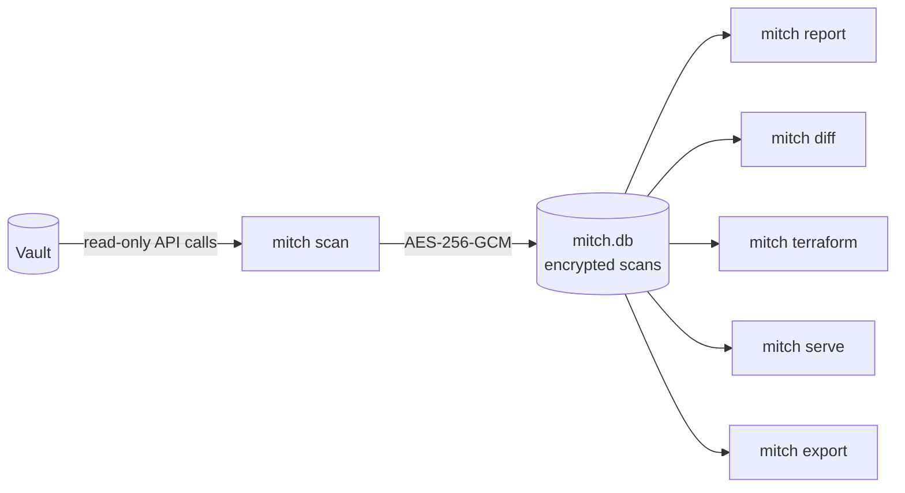

<p align="center">
  
</p>

<h1 align="center">Mitch</h1>

<p align="center">
  <strong>A read-only inventory and audit tool for HashiCorp Vault.</strong><br>
  <a href="https://github.com/jfrappier/mitch/actions/workflows/ci.yml"></a>
</p>

<p align="center">
  <a href="#quick-start">Quick start</a> ·
  <a href="docs/README.md">Documentation</a> ·
  <a href="docs/data-security.md">How your data is protected</a> ·
  <a href="docs/design-decisions.md">Design decisions</a>
</p>

---

People often ask how to run reports in Vault, but Vault is not a CMDB or an inventory tool. Mitch scans a Vault cluster and saves what it finds, encrypted, so you can answer questions like "how many secrets do we have?", "which plugins were installed by hand?" and "what changed since last week?"

> [!NOTE]
> **Early development.** Everything below works today except policy findings, which are not built yet. There is no published release or image yet; build from this repository.

## What Mitch does

| | |
| --- | --- |
| **Scan** | Secrets engines, auth methods, plugins (built in or registered by hand), server configuration, audit devices, namespaces (Enterprise), ACL policies, and KV secret counts. |
| **Report** | A summary of one scan, in the terminal as Markdown, or saved as Markdown or JSON. |
| **Diff** | What changed between two saved scans. |
| **Terraform** | Writes Terraform, with import blocks, so Terraform can adopt your existing Vault setup. |
| **Web UI** | Browse scans, reports and changes in a local, read-only web page. |

## How it works



Only `mitch scan` talks to Vault. Every other command reads the saved scans, so you can report, compare and generate Terraform without a Vault token.

## Quick start

You need a Vault token with Mitch's policy; [Scanning Vault](docs/scanning.md) shows how to create it.

```shell
go build -o mitch ./cmd/mitch      # or: docker build -t mitch .  (see docs/docker.md)

./mitch init                        # create the encrypted database; asks for a passphrase
export VAULT_ADDR=https://vault.example.com:8200
export VAULT_TOKEN=...              # a token with Mitch's policy
./mitch scan                        # scan Vault and save the result
./mitch report                      # summarize the newest scan
./mitch serve                       # browse it in your browser
```

## Design principles

- **Read-only.** Mitch never writes to Vault and never reads secret values. KV secrets are counted, never named.
- **One binary, nothing to install.** A single Go binary for macOS, Linux and Windows, plus a small Docker image.
- **Encrypted at rest.** Scans are encrypted with a key that only your passphrase unlocks. See [How Mitch protects your data](docs/data-security.md).
- **Least privilege.** Mitch prints the exact Vault policy it needs. Endpoints that need `sudo` are skipped unless you opt in with `--sudo`.
- **Fails loudly.** Every skipped check is logged with the reason and the next step, and changes the exit code.

## Documentation

Start at the [documentation index](docs/README.md).

## Supported Vault versions

Vault 1.19 and later, including 2.x. CI tests against 1.19.5 and 2.2.2.

## License

Apache License 2.0. See [LICENSE](LICENSE).
